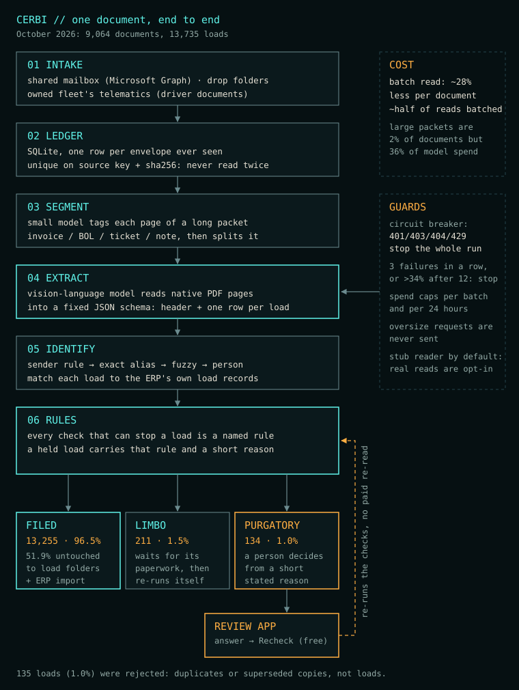

# Case study: Cerbi, AI document automation for freight paperwork

**Role:** sole designer and owner, Business Systems Analyst at Titan Aviation Fuels ·
**When:** September 2026 to now · **Status:** in production ·
**Stack:** Python, SQLite, Claude API (Messages, Files, Batch), Microsoft Graph, HTML/JS, Windows Server, GitHub Actions

---

### The problem

An aviation fuel distributor receives thousands of carrier invoices, bills
of lading and delivery tickets a month, many of them handwritten or scanned
badly, some bundling twenty invoices in one PDF. Every one was printed,
matched to a load, keyed into the ERP and filed in a cabinet by hand. An
off-the-shelf capture tool with AI extraction had been tried; it could not
be taught the company's rules or say why it stopped.

### What I built

**Cerbi**, a document pipeline that:

- pulls paperwork from a shared mailbox, scanner folders and the fleet's
  telematics system, and records each document once;
- splits mixed packets with a small, cheap model, then reads every load with
  a vision-language model into a fixed JSON schema;
- identifies the carrier with exact aliases before fuzzy matching, because
  fuzzy matching alone was confidently wrong on real carrier names;
- runs every load through its business rules;
- files complete loads into their folders and organizes them into ERP
  import batches that a person checks before they go in, and holds the rest with a reason of six words or fewer.

### Results (October 2026)

| | |
|---|---:|
| Documents received | **9,064** (about 380 a weekday) |
| Loads read | **13,735** |
| Loads filed | **96.5%** |
| Filed with no person touching them | **51.9%** |
| Holds a person had to clear | **about 1 in 10**; the rest cleared themselves |
| Email in to filed or held, median | **21 hours** |
| Duplicate invoices closed before payment | **61 loads** |
| Filed loads a person corrected | **2.0%**, a lower bound on errors |

Details and method: [metrics report](cost-and-metrics.md).

### Decisions that mattered

1. **Rules that explain themselves.** Every hold names the rule that stopped
   it. Most improvements after launch came from staff reading hold reasons,
   not from model changes.
2. **Cheap and safe by default.** A stub reader stands in until real reads
   are switched on; batches run at half price under spend caps.
   [ADR 0001](decisions/0001-stub-by-default.md) ·
   [ADR 0003](decisions/0003-batch-by-default.md)
3. **Stop the run, not the document.** After an API key was disabled on the
   first live run (the error handler skipped past one rejected key and sent the next
   document, about 157 times), a circuit
   breaker now ends the run on any credential or configuration error.
   [ADR 0005](decisions/0005-circuit-breaker.md)
4. **Two kinds of "held".** Purgatory for a person, Limbo for paperwork that
   has not arrived. A free Recheck re-decides holds when reference data
   changes. [ADR 0006](decisions/0006-short-reasons-two-queues.md)

### How it was built

I designed the system and wrote its design (an internal document of about
6,000 lines) and the standing rules the code has to follow. AI coding agents
wrote much of the code from those documents, and I reviewed and merged every
change: 1,355 commits and 485 merged pull requests in six weeks, held
together by about 3,800 tests that run on every push.

### What I learned

- Budget from production, not samples. Measured cost came in at about
  1.75× the first estimate. Large packets, 2% of documents, turned out to
  be over a third of the spend.
- Put explanations in front of the people who act on them. A six-word reason
  turned Purgatory from a backlog into a to-do list. Staff read those
  reasons and asked for rule changes, and those changes, not model changes,
  shrank it.
- Report the strict number too. 96.5% filed sounds better than 51.9%
  untouched; showing both is what makes either believable.
- AI agents build quickly; the hard part is the written rules that keep
  their work consistent.
