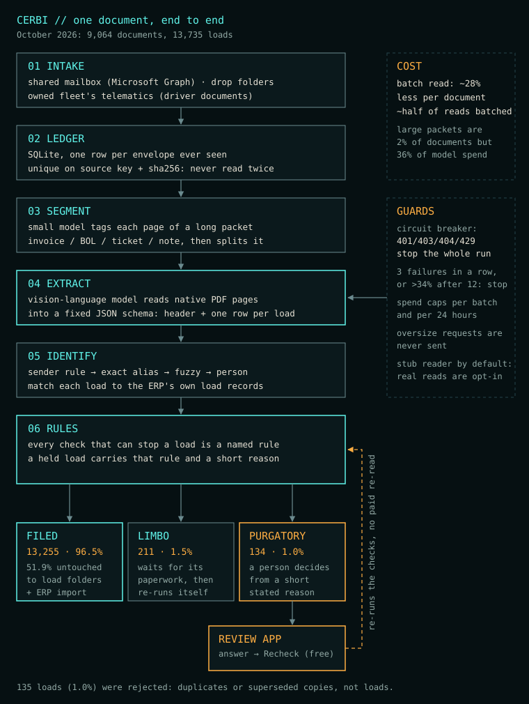

# Cerbi: design document

**Author:** Trevor Dane Respress, Business Systems Analyst, Titan Aviation Fuels ·
**Status:** in production since September 2026; ERP import batches built and
checked by a person, production cutover pending · **As of:** 10 November 2026

*This is the portfolio version of Cerbi's internal design document. The
internal one is about 6,000 lines and lives in a private repository. Names
of carriers, customers, coworkers and internal systems are left out here;
the architecture, decisions and numbers are real.*

Related: [metrics](cost-and-metrics.md) ·
[case study](case-study.md) · [decision records](decisions/) ·
[architecture diagram](architecture.svg)

---

## 1. Summary

Cerbi reads freight paperwork for an aviation fuel distributor. Carrier
invoices, bills of lading (BOLs), delivery tickets and driver notes arrive
by email and from scanners, often handwritten or badly scanned. Cerbi works
out what each page is and who sent it, reads every load on it with a
vision-language model, checks each load against its business rules, and then does one of three things:

- **files** the load: copies the paperwork into that load's folder and adds it
  to an ERP import batch;
- parks it in **Limbo**, when it is waiting for paperwork that has not
  arrived yet (a BOL before its invoice);
- holds it in **Purgatory** for a person, with a reason of six words or fewer.

In October 2026 it received **9,064 documents** carrying **13,735 loads**.
**96.5%** of loads were filed, **51.9%** with no person touching them;
1.5% waited in Limbo and 1.0% on a person. Duplicate checks closed 61
duplicate invoice loads before they could be paid twice.

## 2. Problem

Before Cerbi, every carrier invoice was handled by hand:

1. Someone printed the invoice and the matching BOL.
2. Someone found the load in the ERP, worked out the freight rate and keyed
   the invoice.
3. Someone filed the paper packet by date and carrier, and later matched it
   again for profit and loss reporting.

That is several people touching each document. The paperwork is hard for
software, too:

- **Mixed packets.** One PDF can hold 21 separate invoices, or eight
  invoice-and-BOL pairs, with every page footed "Page 1 of 1".
- **Bad input.** Handwritten tickets, phone photos and 600 dpi scans.
- **Ambiguous senders.** Many carriers bill through the same accounting
  platforms, so the sender address often does not say who the carrier is.
- **Many loads per document.** 1.55 loads per document on average, and one
  invoice can span several loads.

An earlier attempt used an off-the-shelf capture product with a built-in AI
extraction step. It worked for clean invoices but could not be taught the
company's rules, could not explain why it stopped, and broke when its table
schema changed. Cerbi replaced it.

## 3. Goals and non-goals

**Goals**

- File every complete document with no person involved.
- When something stops, say why in a few words, and let a person fix it in
  one step.
- Make every business rule explain itself: a held load names the rule that
  held it.
- Spend on the model deliberately: cheap by default, capped, and measured.
- Never lose a document and never read the same one twice by accident.

**Non-goals**

- Replacing the ERP. Cerbi feeds it.
- Fully automatic sender learning. A person approves every new sender rule
  (see [ADR 0004](decisions/0004-exact-before-fuzzy.md)).
- Real-time processing. Paperwork arriving within the hour is fine, which is
  what makes the Batch API usable.

## 4. Architecture

Cerbi is one flat Python package with no web framework and no build step. It
runs as a service on a Windows server, stores its state in SQLite, and serves
a single-page review app to staff signed in with their Windows accounts. The
internal web platform it files into was built by a teammate.

| Stage | What it does | Key design choice |
|---|---|---|
| 01 Intake | Pulls documents from a shared mailbox (Microsoft Graph), watched drop folders, and the owned fleet's telematics system. | The mailbox reader is read-only and has a not-before cutoff so old mail is never reprocessed. |
| 02 Ledger | Records one row per envelope ever seen. | Idempotency lives here: a unique key on the source plus a content hash, so the same attachment arriving twice is read once. The raw source is kept so any document can be re-read later. |
| 03 Segment | Splits long packets into invoices. | A small, cheap model tags each page (invoice, BOL, ticket, note, statement) for a small fraction of the cost of a read; pages are grouped before the expensive read. |
| 04 Extract | Reads each group into structured JSON. | Native PDF document blocks rather than rasterised images (cheaper and more accurate); a fixed output schema; no generated placeholders; requests that cannot succeed are never sent. |
| 05 Identify | Works out the carrier and matches each load to the ERP's records. | Exact alias table first, fuzzy match second, person third. Fuzzy matching alone was *confidently wrong* 4 times in 94 on real carrier names. |
| 06 Rules | Runs every check and decides the outcome. | Every check that can stop a load has a name, and a held load carries it. |
| Outcome | Filed, Limbo or Purgatory. | A filed load's paperwork is copied into its load folder with a manifest and SHA-256 per file; filed invoices are organized into an ERP import batch that a person checks before it goes in. |

### 4.1 Rules

Every check that can hold, discard or route a load is a named rule. A held
load names the rule that held it and carries a short reason (see 4.2).

### 4.2 Holds: Purgatory and Limbo

Two queues, because "held" meant two different things:

- **Purgatory**: a person must decide. Each hold carries a *short reason*
  (at most six words, never a value, the same words for every load held
  there) plus a longer note with the numbers and what to do.
- **Limbo**: nothing for a person to do yet. A BOL that arrives before its
  invoice parks here and files itself when the invoice lands.

A held load is an appeal, not a dead end. The **Recheck** button re-runs
every rule against fresh reference data *without* paying for another model
read: a value a person typed is kept, a duplicate of an already-filed invoice
closes, and a load that now matches the ERP files. See
[ADR 0006](decisions/0006-short-reasons-two-queues.md).

In production about half of all loads are held at least once, mostly
because an invoice and its BOL arrive separately. In October about 4 in 10 holds were cleared by Cerbi itself, about 4 in 10
were replaced by a fresh read, and about 1 in 10 needed a person. Paperwork-timing holds mostly clear
themselves; missing information (carrier, delivery date, BOL number) almost
always needs a person.

### 4.3 Extraction

- **Model:** Claude Sonnet for reading, with Claude Haiku for page tagging
  and signature checks.
- **Input:** native PDF document blocks, uploaded through the Files API when
  large. An early version rasterised pages to PNG at 200 dpi; it paid for
  detail the API downsampled away and turned a 53 KB PDF into a 134 KB
  request.
- **Output:** a header (vendor, invoice number, date, amount, remit-to) and
  one row per load (BOL, load number, delivery date and state, gallons,
  charges, source page). One prompt for every carrier, with per-carrier
  context added, rather than per-carrier prompts that drift apart.
- **The read is a suggestion.** Extraction runs even when the sender is
  unknown, and its read of the vendor pre-fills the review card. A person
  confirms with one click instead of searching a 3,125-row vendor list.
- **Evaluation-set results** (51 labelled documents, a small sample): vendor correct 92%, carrier
  ID resolved 96%, delivery state 96%, delivery date 94%, BOL number 92%,
  invoice number 84% (coverage, not correctness, for the last five).

### 4.4 Batches

Most paperwork is not urgent, so reads go through the Batch API at half
price. Automatic batching submits when enough documents are waiting or the
oldest has waited long enough, under a per-batch and a per-24-hour spend
cap. A batch is planned, priced, trimmed to its cap and then submitted;
results are collected into the ledger with the real token usage. See
[ADR 0003](decisions/0003-batch-by-default.md).

In October about half of the documents that needed a read went by batch,
at about 28% less per document than a live read. Turnaround from email to filed or held was a median of 21
hours in October, the first month of day-to-day running.

### 4.5 The review app

Four main views over one ledger: the **Master Ledger** (every load, every
value, every tag), **Purgatory**, **Limbo** and **Reports**. Purgatory has a card view that shows each page beside the
values read from it. Bulk actions (recheck, send to Limbo, send to a group,
send to an action) work on filtered lists.
A **Console** runs every operational command, so no server step needs a
shell.

## 5. Data model

SQLite behind a thin repository layer.

| Table | One row per | Notes |
|---|---|---|
| `source_message` | envelope ever seen | the ledger; unique on source key |
| `page` | page | page type and which invoice it belongs to |
| `invoice` | invoice found in a document | several per document is normal |
| `load_row` | load | the unit that is filed or held |
| `tag` | fact about an object | value plus provenance (`read`, `rule`, `human`, `vlm`) |
| `validation_task` | open issue | one per issue, not per document |
| `vendor_alias` | extracted name → carrier id | grows as people resolve holds |
| `sender_rule` | address or domain → carrier | written only by a person |
| `processing_run` / `processing_item` | run / document in a run | every document in every run |
| `audit_event` | event | append-only |

Provenance is the important column. A carrier tagged by the model is enough
to file a document; it is never enough to create a sender rule.

## 6. Reliability and safety

The first real run taught most of this section. Within 20 minutes of the
first live extraction, the API key was disabled. The cause was not volume
(the run had spent almost nothing) but shape: the per-document error handler treated an
authentication failure like a bad PDF and moved on, so one rejected request
became about 157 failed requests in a row, which looks like credential probing from outside.
Four rules came out of it, all built:

1. **Debug with one document.** `run.py document <file>` drives one file end
   to end.
2. **Abort on fatal errors.** 401, 403, 404 and 429 stop the whole run.
   Three failures in a row, or a failure rate above about 34% after twelve
   documents, also stop it. A corrupt PDF does not.
   See [ADR 0005](decisions/0005-circuit-breaker.md).
3. **Never send a request that cannot succeed.** Size and page count are
   checked before sending; oversized documents are uploaded instead.
4. **A key belongs to one application.** The key is encrypted with Windows
   DPAPI, decrypted only into the one process that needs it, and a
   pre-commit hook refuses anything shaped like a live key.

Also:

- **Stub by default.** Without a key, a stub extractor stands in, so every
  stage except the read can be tested for free. See
  [ADR 0001](decisions/0001-stub-by-default.md).
- **Spend caps** per batch and per 24 hours; a throttle with a speed dial
  and a pause.
- **Nightly ledger backups** taken by the app itself, plus one before every
  update.
- **Gentle on the live app.** After review agents once sent the live app
  enough requests in a few minutes to take it down, bulk reads come from one export request and are analysed
  locally; spot checks are one at a time, at most about 50 per task.

## 7. Testing and quality

- **About 3,800 test functions in 210 modules** (67,000 lines of tests
  against about 82,000 lines of application Python), run in CI on every
  push, before every update on the server, and isolated from the machine's
  real mail folders and workbook. No key and no network needed.
- **Three harnesses:** `selfcheck` (configuration), `wiretest` (one real
  call end to end) and `evaluate` (a labelled set of 51 documents scored per
  field). A prompt change can be scored against the published prompt before
  it is published, with both scores side by side.
- **UI rules as tests.** The review app's style rules (tokens, button
  classes, an inline-style budget that can only go down) are checked in CI.
- **Reviews from exports.** Periodic reviews read full Ledger and Purgatory
  exports and rank findings; the 6 October review led to the rule changes
  that shrank Purgatory (see [ADR 0006](decisions/0006-short-reasons-two-queues.md)).
- **An analytics export** reads the whole ledger in one pass: volumes,
  outcomes, holds by reason, turnaround, cost by read path, failures and
  corrections. In October: 5 of 9,064 documents failed outright; people
  corrected 2.0% of filed loads (a lower bound on read errors, not a
  precision figure).

## 8. How it was built

- **Timeline:** first commit 15 September 2026; in production within weeks;
  1,355 commits, 485 merged pull requests and 193 release tags by
  26 October.
- **Method:** I designed the system, wrote the design documents and rules,
  and reviewed and merged every change. AI coding agents (Claude Code) wrote
  much of the code from those documents: about 70% of commits are
  agent-authored, each one reviewed before merging. The repository's standing rules (short
  reasons, every command runnable from the Console, go gently on the live server) exist to keep that work consistent.
- **Stack:** Python, SQLite, the Claude API (Messages, Files and Batch),
  Microsoft Graph, a single-page HTML/JavaScript app, Windows Server with
  IIS and Windows sign-in, GitHub Actions.

## 9. What is next

| Item | Why | Expected effect |
|---|---|---|
| ERP import cutover | Filed invoices are organized into import batches that a person checks; the cutover to production import is pending | the largest remaining time saving |
| Cheaper large packets | 2% of documents (long packets split into invoice groups) are 36% of model spend | the largest single cost reduction available |
| Prompt caching | The prompt is identical on every call, and repeated for every group of a packet | cuts the input side; output is about half the cost |
| Fleet documents straight from telematics | The owned fleet's tickets are retyped | removes a second keying step |
| Local vision model research | Spend, data residency | research only; measured with the same evaluation set |
| Highlight learning | Boxes people draw on pages are recorded | training data for where values sit on each carrier's layout |

## 10. Lessons

1. **Let every hold explain itself.** Most of the improvement after launch
   came from operations staff reading hold reasons and asking for a rule to
   change, not from model changes.
2. **Measure before you budget.** The cost estimate, derived from documented
   image-token formulas, was low: measured cost came in at about 1.75× the
   estimate. The measured figure is the
   one in every plan now.
3. **Fuzzy matching fails confidently.** Raising a threshold cannot fix a
   name that genuinely sits closer to the wrong carrier. An exact alias
   table, grown by people, can.
4. **An error is either about the document or about the run.** Treating the
   second like the first is how a run that had spent almost nothing lost an API key.
